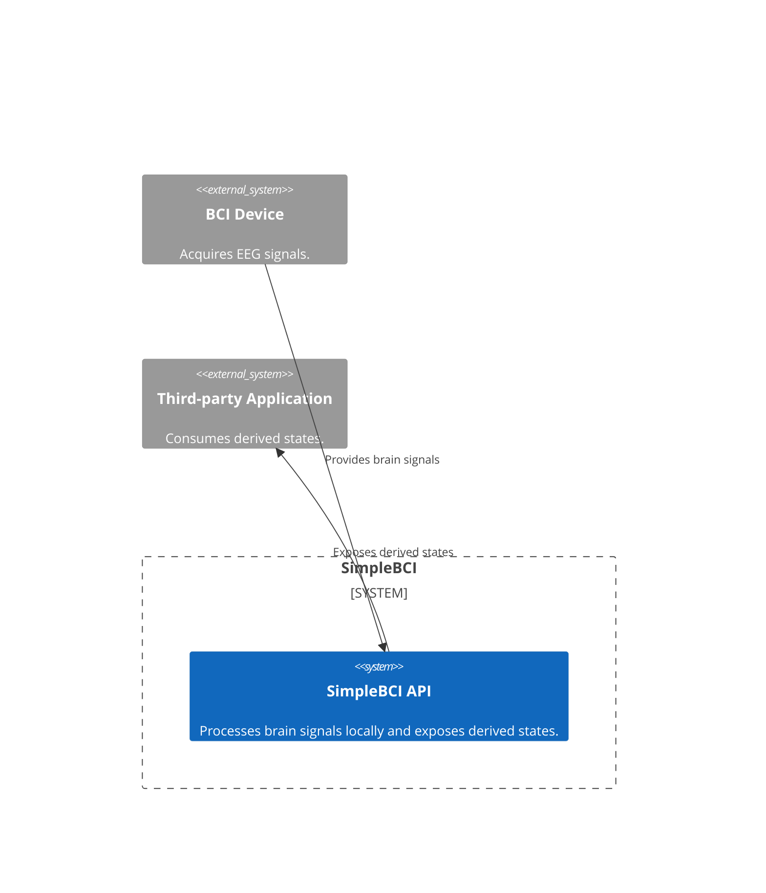
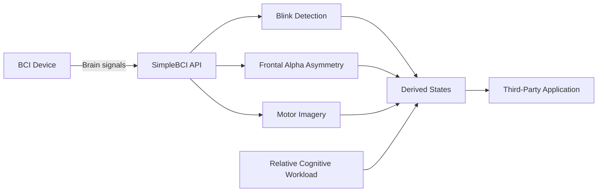

# SimpleBCI

SimpleBCI is an early-stage C# prototype that explores a simple, device-agnostic API for consumer brain-computer interfaces (BCIs).

The project is part of a Computer Science project at Örebro University and focuses on privacy and security in BCIs. Instead of exposing raw brain signals to applications, SimpleBCI aims to provide access to task-specific results through a simple, command-oriented API while keeping signal processing local.

## Architecture

SimpleBCI acts as an intermediary between a BCI device and third-party applications. It processes brain signals locally and exposes derived states through a public API.

### System Context

The system context shows how SimpleBCI connects a BCI device to third-party applications while keeping processing within the API boundary.



### EEG Processing Flow



## Current Scope

The prototype provides access to three BCI paradigms:

- **Blink Detection:** Detects no blink, a single blink, or a double blink.
- **Frontal Alpha Asymmetry (FAA):** Provides a state derived from frontal alpha asymmetry.
- **Motor Imagery:** Classifies left, neutral, or right motor imagery.
- **Cognitive Workload:** Estimates whether frontal theta power is elevated relative to a personalized low-workload baseline. This is an exploratory workload estimate, not a general concentration or performance measure.

The API is designed to abstract device-specific details and provide a consistent interface for applications.

Blink detection selects the first complete channel pair available in this order:
FP1/FP2, AF7/AF8, then F7/F8. The selected positions are available through
`BciClient.BlinkDetectionChannels`; `IsBlinkDetectionAvailable` is false when
none of the pairs is mapped.

FAA selects a complete pair in this order: F3/F4, F7/F8, AF7/AF8, then
FP1/FP2. The selected pair is exposed through `BciClient.FaaChannels`.
Cognitive workload estimation selects Fz first, then the first available pair
in this order: F3/F4, AF7/AF8, F7/F8, FP1/FP2. Its selected channel(s) are
exposed through `BciClient.CognitiveWorkloadChannels`. Pair-based workload
estimation averages the log theta power across the selected pair. Muse can
therefore continue to provide an exploratory, individually calibrated estimate
using AF7/AF8, while a NeuroPawn layout containing Fz uses Fz preferentially.

### Signal scaling and calibration

EEG amplitudes depend on the device, its gain and units, electrode contact, the
user, and the recording environment. The 20–100 µV range cited by Sewell et al.
is useful as broad clinical context, but it is not a universal operating range
for consumer devices or a suitable target for rescaling. Multiplying a noisy
signal to fit that range changes the numeric scale; it does not remove
interference, identify blinks, or recover a clean EEG signal. The API therefore
does not rescale incoming signals to that range.

Where a feature depends on a person's pattern, prefer a task-specific
calibration: motor imagery already has trial calibration, and cognitive
workload is expressed relative to a low-workload baseline. Blink detection
uses a moving-baseline correction and estimates its amplitude threshold from
the robust spread (median absolute deviation) of each channel's current
analysis window. That reduces dependence on device gain and units, but cannot
distinguish every blink from high-amplitude interference or poor electrode
contact. Signal quality checks and validation across devices and environments
remain necessary.

FAA is calculated as a log alpha-power difference. Its mathematical form is
scale-relative, but a fixed threshold used to label the result as
approach-related or avoidance-related is still a heuristic; it should not be
treated as a universal or clinically validated interpretation.

## Privacy and Security

EEG signals can contain sensitive personal information beyond what an application requires for its intended task. SimpleBCI explores a privacy-oriented approach in which signal processing takes place locally and applications receive only task-specific results.

The prototype does not yet provide a complete or formally validated privacy guarantee. The information exposed by the API and the potential for sensitive information to be inferred from derived states must still be evaluated.

## Project Structure

- `SimpleBCI.Library`: C# library and public API.
- `SimpleBCI.TestApplication`: Example application.
- `SimpleBCI.Tests`: Unit tests.

## Requirements

- .NET 10 SDK
- A compatible BCI device or simulated input source

## Build

```bash
dotnet build SimpleBCI.slnx
```
