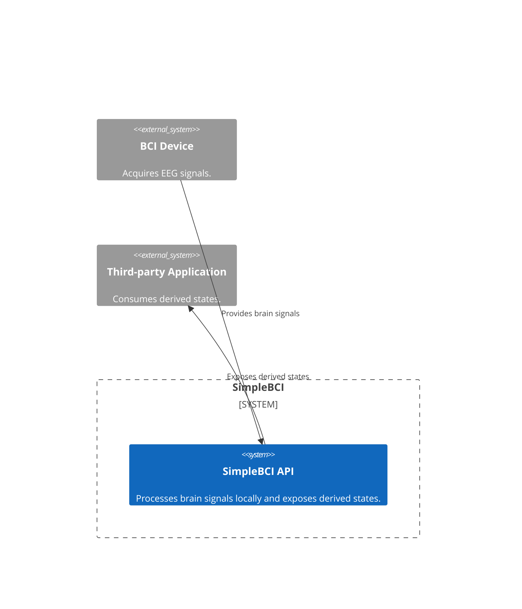
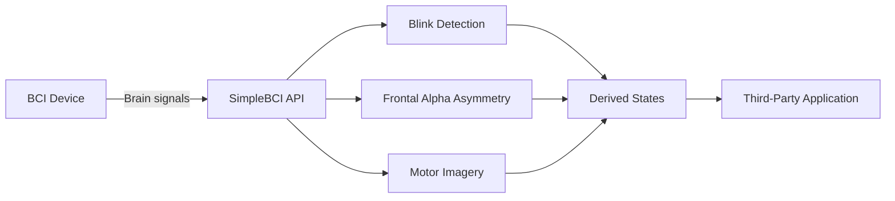

# SimpleBCI

SimpleBCI is an early-stage C# prototype that explores a simple, device-agnostic API for consumer brain-computer interfaces (BCIs).

The project is part of a Computer Science project at Örebro University and focuses on privacy and security in BCIs. Instead of exposing raw brain signals to applications, SimpleBCI aims to provide access to task-specific results through a simple, command-oriented API while keeping signal processing local.

## Architecture

SimpleBCI acts as an intermediary between a BCI device and third-party applications. It processes brain signals locally and exposes derived states through a public API.

### System Context

The system context shows how SimpleBCI connects a BCI device to third-party applications while keeping processing within the API boundary.



### EEG Processing Flow



## Current Scope

The prototype provides access to three BCI paradigms:

- **Blink Detection:** Detects no blink, a single blink, or a double blink.
- **Frontal Alpha Asymmetry (FAA):** Provides a state derived from frontal alpha asymmetry.
- **Motor Imagery:** Classifies left, neutral, or right motor imagery.

The API is designed to abstract device-specific details and provide a consistent interface for applications.

## Privacy and Security

EEG signals can contain sensitive personal information beyond what an application requires for its intended task. SimpleBCI explores a privacy-oriented approach in which signal processing takes place locally and applications receive only task-specific results.

The prototype does not yet provide a complete or formally validated privacy guarantee. The information exposed by the API and the potential for sensitive information to be inferred from derived states must still be evaluated.

## Project Structure

- `SimpleBCI.Library`: C# library and public API.
- `SimpleBCI.TestApplication`: Example application.
- `SimpleBCI.Tests`: Unit tests.

## Requirements

- .NET 10 SDK
- A compatible BCI device or simulated input source

## Build

```bash
dotnet build SimpleBCI.slnx
```