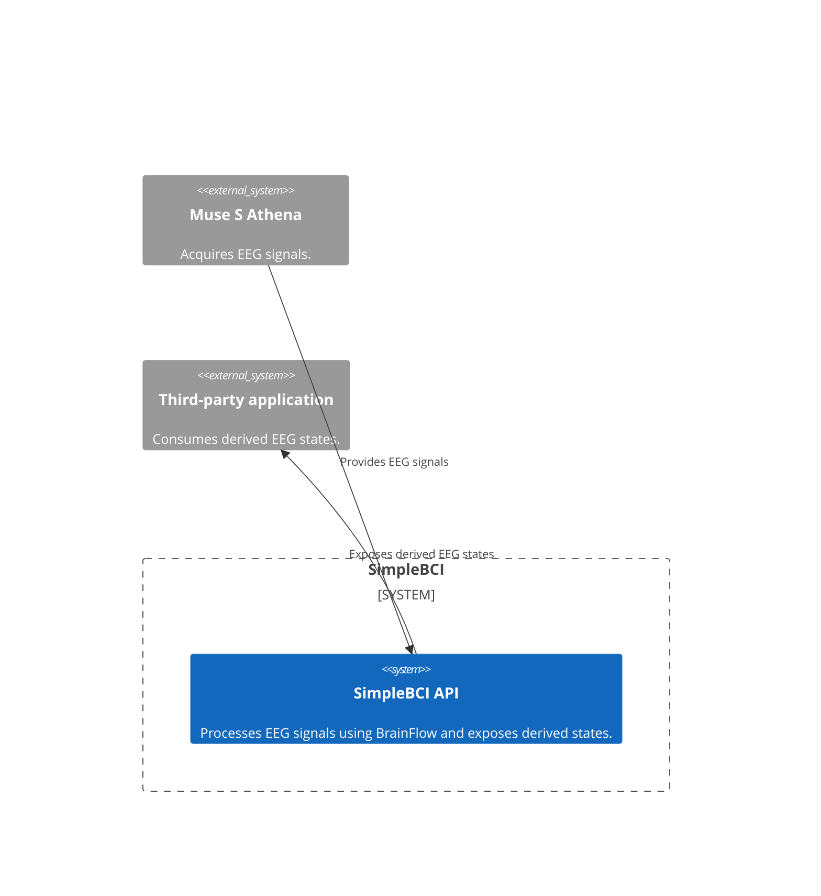
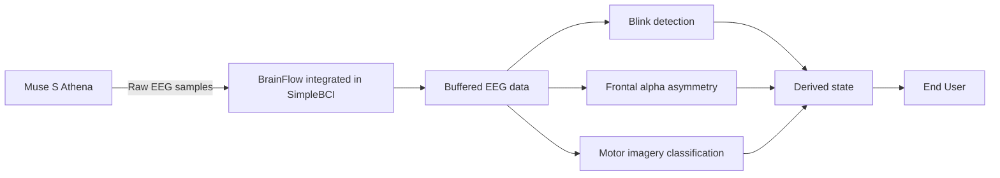

# SimpleBCI

SimpleBCI is an early-stage C# prototype built with BrainFlow. It explores
a simple, command-oriented API for consumer EEG applications, using the
Muse S Athena as data sources.

The project is part of a project work in Computer Science at Örebro University.
It explores privacy and security in brain-computer interfaces. EEG can contain
sensitive information, while applications may only need a small set of
task-specific results. SimpleBCI processes EEG locally and exposes derived
states through a library API.

## Architecture

The diagrams below show the system context and the local EEG processing flow.
BrainFlow is integrated into the SimpleBCI API and handles communication with
the selected board and access to its EEG data.

### System context



### EEG processing flow



## Current scope

The library currently provides a facade for accessing derived states:

- Motor imagery classification: left, neutral, or right
- Frontal alpha asymmetry (FAA) state
- Blink detection: no blink, single blink, or double blink

The library uses BrainFlow to access board data. Classification and state
calculation are performed locally in the library. Supported sources include
the Muse S Athena and BrainFlow's synthetic board.

This is a prototype, not a validated medical or research instrument. The
current implementation does not provide a complete privacy guarantee:
callers should review what data and capabilities the API exposes before using
it in an application.

## Project structure

- `SimpleBCI.Library`: C# library and public API
- `SimpleBCI.TestApplication`: example application
- `SimpleBCI.Tests`: unit tests (rudimentary) 
- `SimpleBCI.ML`: scripts and data used for the motor imagery model

## Requirements

- .NET 10 SDK
- A supported BrainFlow board, such as the Muse S, or the synthetic board

## Build

```bash
dotnet build SimpleBCI.slnx